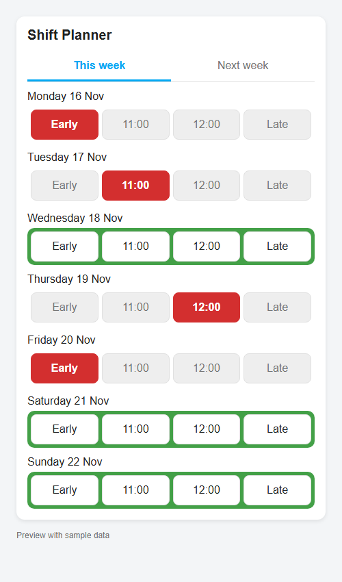

# ha-shift-planner-card
Home Assistant card to show the work shift of the current or next week.

Requires the [Shift Planner integration](https://github.com/mrunde/ha-shift-planner)
to be installed and configured in Home Assistant.

Switch between weeks using the tabs. Selected shifts have a red background and
white text; other shifts on the same day are greyed out and cannot be selected.
Days without a shift remain green and allow you to create a shift. The card
updates automatically when its Home Assistant sensor changes.

## Preview

